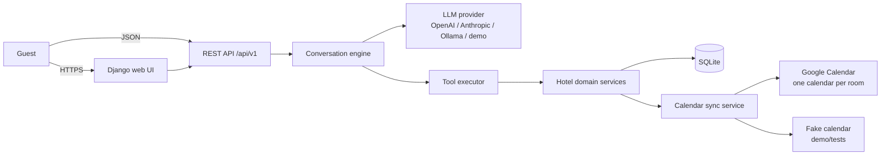
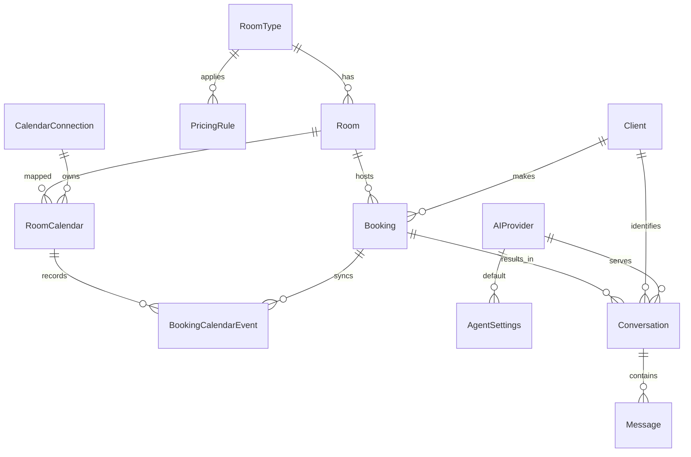
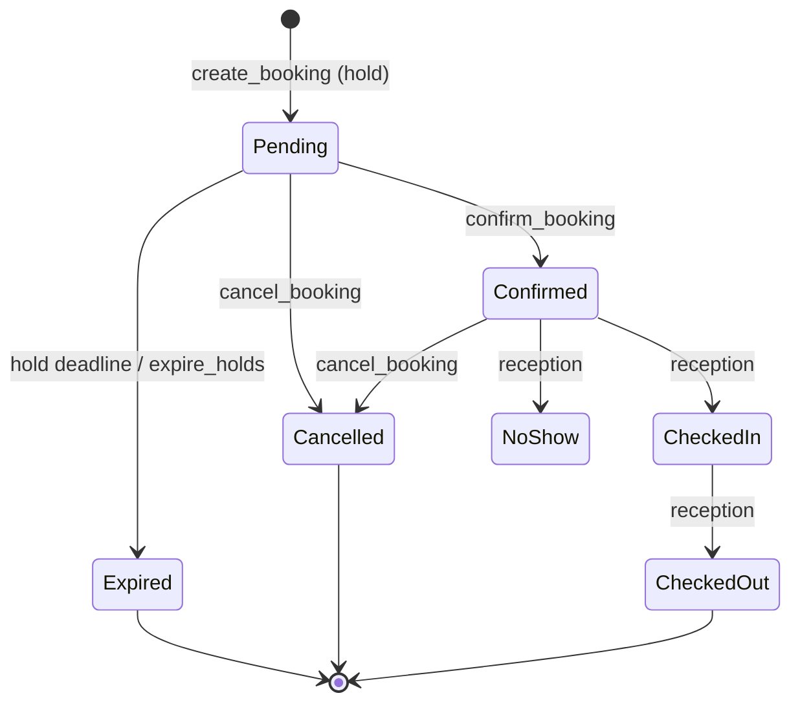
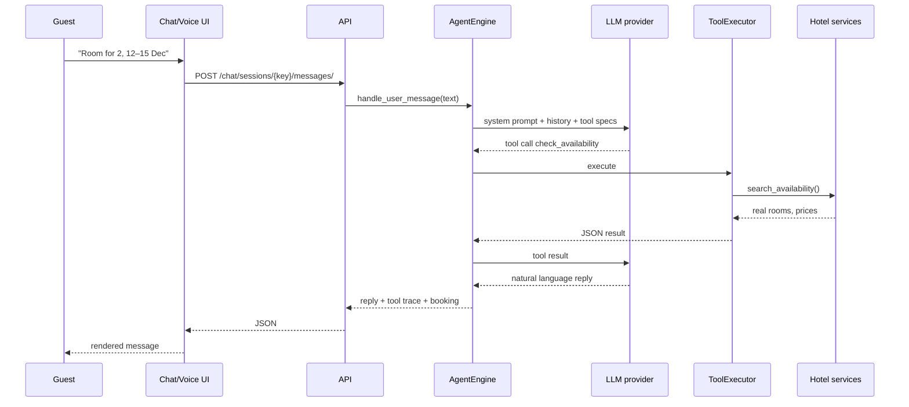

# Architecture

Hotel Aurora is a Django 5.2 application with a provider-agnostic AI conversation layer. The same domain services and tools are used by the website, the REST API, the chat concierge and the voice concierge.

## System context



The browser talks to the Django app. Chat and voice both create a `Conversation` and send user text to `POST /api/v1/chat/sessions/<key>/messages/`. The engine calls an LLM, executes tools against the hotel domain, and returns a reply plus any booking state. The web UI never decides availability or prices itself.

## Applications

| App | Responsibility |
| --- | --- |
| `apps.hotel` | Rooms, room types, clients, pricing rules, bookings, availability, transactional booking service, admin, seed/ops commands |
| `apps.api` | DRF serializers, views, URL routing, throttling and the JSON error envelope |
| `apps.agents` | Provider-agnostic conversation engine, tool definitions/execution, prompts, provider and conversation models |
| `apps.providers` | LLM connectors (OpenAI, Anthropic, Ollama, demo) behind a shared interface |
| `apps.voice` | Speech-to-text / text-to-speech provider abstraction and browser client config |
| `apps.calendar_sync` | Calendar connections, per-room mappings, event records, fake/Google adapters, sync service |
| `apps.web` | Public Django templates and page views |

`apps.providers` is a plain Python package rather than a Django app: it has no models or migrations.

## Domain model



### RoomType and Room

- A **RoomType** is the sellable product: name, slug, capacity, base price, currency, size, beds, amenities.
- A **Room** is a physical unit (`101`, `102`, …) belonging to exactly one room type.
- Availability is calculated per physical room, so two bookings cannot occupy the same room on overlapping nights.

### PricingRule

Rules are applied **per night**, in priority order. Percentage adjustments are summed, fixed adjustments are added, and the result is floored at zero.

Supported kinds: seasonal, weekend, last-minute and long-stay. A rule can target one room type or all room types, can have a date window, weekday mask (`0` = Monday) and a minimum-night condition.

All amounts are **gross and VAT-inclusive**. `tax_included` is informational, derived from `HOTEL["tax_rate"]`:

```text
tax_included = subtotal * rate / (1 + rate)
```

### Booking state machine



- A **pending** booking blocks its room until `hold_expires_at` (30 minutes by default).
- **Confirmed**, **checked-in** bookings always block the room.
- **Cancelled**, **expired** and **no-show** bookings never block.
- The booking reference is human-friendly (`HA-7KQ2M4`) and generated without ambiguous characters.

`apps.hotel.booking_service` is the only write path. It locks the room type row (`select_for_update`), checks capacity and availability, prices the stay, deduplicates/creates the client, validates and saves the booking, and schedules calendar sync with `transaction.on_commit`.

### Availability

`available_rooms()` excludes rooms with overlapping blocking bookings:

```text
booking.check_in < requested.check_out AND booking.check_out > requested.check_in
```

A pending booking counts only while `hold_expires_at` is null or in the future. `search_availability()` returns one entry per eligible room type with remaining rooms, room numbers and a full quote.

## AI conversation layer



### Provider abstraction

`apps/providers/base.py` defines the shared shapes:

- `ChatMessage` (role, content, tool calls, tool-call id, name)
- `ToolCall` (id, name, arguments)
- `ToolSpec` (name, description, JSON Schema)
- `LLMResponse` (content, tool calls, usage, model, provider)
- `LLMProvider` (`chat()`, `health_check()`)

Each connector translates to and from its vendor format. `resolve_provider()` selects the active default `AIProvider`, decrypts nothing (the key is stored as-is in SQLite for the alpha), and falls back to the demo policy if the configured provider is unusable. This fallback is deliberate: a missing key must not break the reception desk.

### Tools

The model can only affect the world through these tools:

| Tool | Effect |
| --- | --- |
| `check_availability` | Read-only availability search |
| `get_pricing` | Read-only nightly breakdown |
| `create_booking` | Create a pending hold and attach it to the conversation |
| `confirm_booking` | Confirm a hold |
| `get_booking` | Read a booking by reference |
| `cancel_booking` | Cancel a booking |

Tool handlers are defensive: invalid arguments and domain errors become `{"ok": false, "error": ...}` results instead of exceptions, so the model can recover in the next turn.

The engine stores every user, assistant and tool message. `conversation_history()` exposes only user/assistant messages to the UI. A tool loop is capped by `AgentSettings.max_tool_iterations` (6 by default) to avoid runaway calls.

### Prompts and settings

`AgentSettings` is a singleton (`pk=1`) holding:

- assistant name, enabled flags for chat/voice;
- English and Polish system prompts, greetings and fallbacks;
- default provider, tool-iteration limit, hold duration;
- STT/TTS provider names and voice names.

The system prompt is assembled at request time with runtime context: hotel name, today's date, currency, check-in/out times, hold duration, channel and active room types. The guest language is appended as an explicit instruction.

## Voice

`apps.voice.providers` defines `BaseSTTProvider` and `BaseTTSProvider`.

- **Browser** (default): the page uses `SpeechRecognition` and `speechSynthesis`. No audio leaves the browser.
- **OpenAI**: `OpenAISTTProvider` posts audio to `/audio/transcriptions`; `OpenAITTSProvider` posts text to `/audio/speech`.

`GET /api/v1/voice/config/` tells the browser which mode to use, the available languages (`en-US`, `pl-PL`), greeting text and voice names. The voice page reuses the chat session/message endpoints, so business logic is identical across channels.

## Calendar sync

The design target is **one Google Calendar per room**.

- `CalendarConnection` stores the provider (`google` or `fake`), default calendar id, credentials JSON and sync flags.
- `RoomCalendar` is a one-to-one mapping from a room to a calendar id.
- `BookingCalendarEvent` is the idempotency record: one per booking + mapping, with `pending` / `synced` / `failed` / `deleted`, the external event id and the last payload.

Sync runs after commit:

1. `confirm_booking()` / `cancel_booking()` register `transaction.on_commit`.
2. `sync_booking()` finds the room mapping and skips when absent or disabled.
3. Pending bookings are not synced.
4. Confirmed/checked-in bookings are created or updated; cancelled/expired/no-show events are deleted.
5. Errors are persisted, never raised into the booking flow.
6. `sync_calendars --retry-failed` retries failed records.

Google credentials can come from the connection's `credentials_json` or from `GOOGLE_CALENDAR_CREDENTIALS_FILE`. Service accounts and authorised-user OAuth tokens are both accepted.

## Internationalisation

- Django `LocaleMiddleware` with `en` and `pl`.
- `LANGUAGES` drives the language switcher in `base.html`.
- Templates use `` / ``.
- Python domain errors use `gettext` / `gettext_lazy`.
- `locale/pl/LC_MESSAGES/django.po` + `.mo` provide Polish.
- `scripts/update_translations.py` extracts strings without GNU gettext; `scripts/pl_translations.py` is the translation dictionary; `scripts/compile_translations.py` writes the binary catalogue.
- Chat/voice UI strings are passed to JavaScript through `data-msg-*` attributes and inline i18n JSON, so the JS stays translation-aware without a build step.

## Settings and deployment

| Settings module | Use |
| --- | --- |
| `config.settings.base` | Shared configuration, env parsing, apps, middleware, DB, i18n, logging |
| `config.settings.dev` | `DEBUG=True`, permissive hosts, browsable API |
| `config.settings.prod` | `DEBUG=False`, WhiteNoise compressed manifest storage, optional TLS/HSTS |
| `config.settings.test` | In-memory SQLite, fast hashing, no throttling, fake calendar |

Docker uses `config.settings.prod`. Gunicorn serves the WSGI app; WhiteNoise serves hashed static files. SQLite is stored in the `hotel_data` volume. The health endpoint checks the database with `SELECT 1`.

### Security posture

Implemented: CSRF, clickjacking protection, HttpOnly session cookies, SameSite=Lax, optional secure cookies/HSTS, API throttling, no card data collection.

Deliberately out of scope for the alpha: guest accounts, payment, encrypted provider keys at rest, per-IP persistent throttling, audit trail, virus scanning of uploads, multi-factor admin, rate limiting at the proxy.

## Extension points

- Add a channel by creating a `Conversation` with a new channel value and reusing the message endpoint.
- Add an LLM vendor by implementing `LLMProvider` and registering it in `apps/providers/registry.py`.
- Add a speech vendor by implementing `BaseSTTProvider` / `BaseTTSProvider` and extending the factories.
- Add a calendar vendor by implementing the calendar provider interface and adding a `CalendarConnection.Provider` choice.
- Add a pricing dimension by extending `PricingRule` and `applies_to()` / `adjust()`.
- Add a tool by adding a `TOOL_SPECS` entry and a `_tool_*` handler in `apps/agents/tools.py`.
