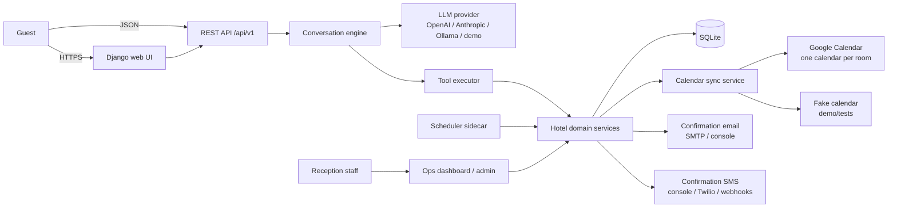
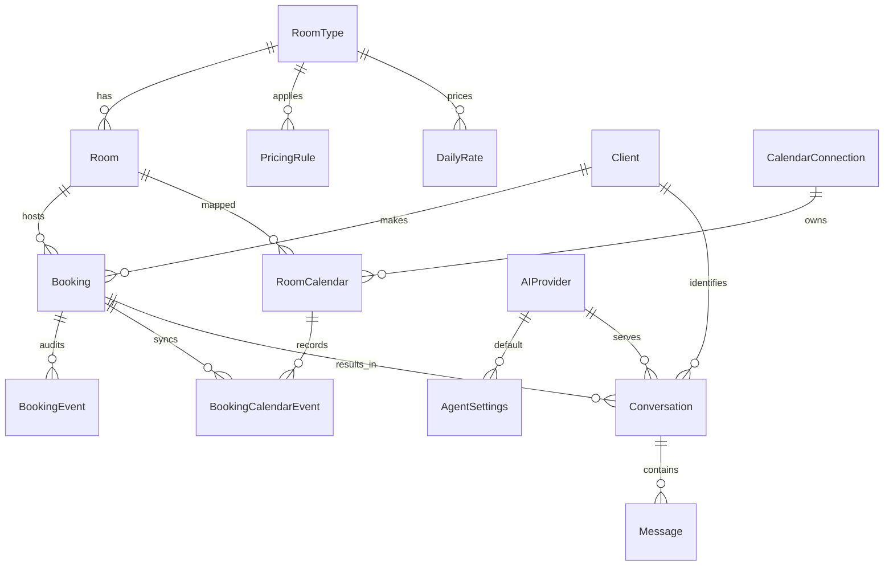
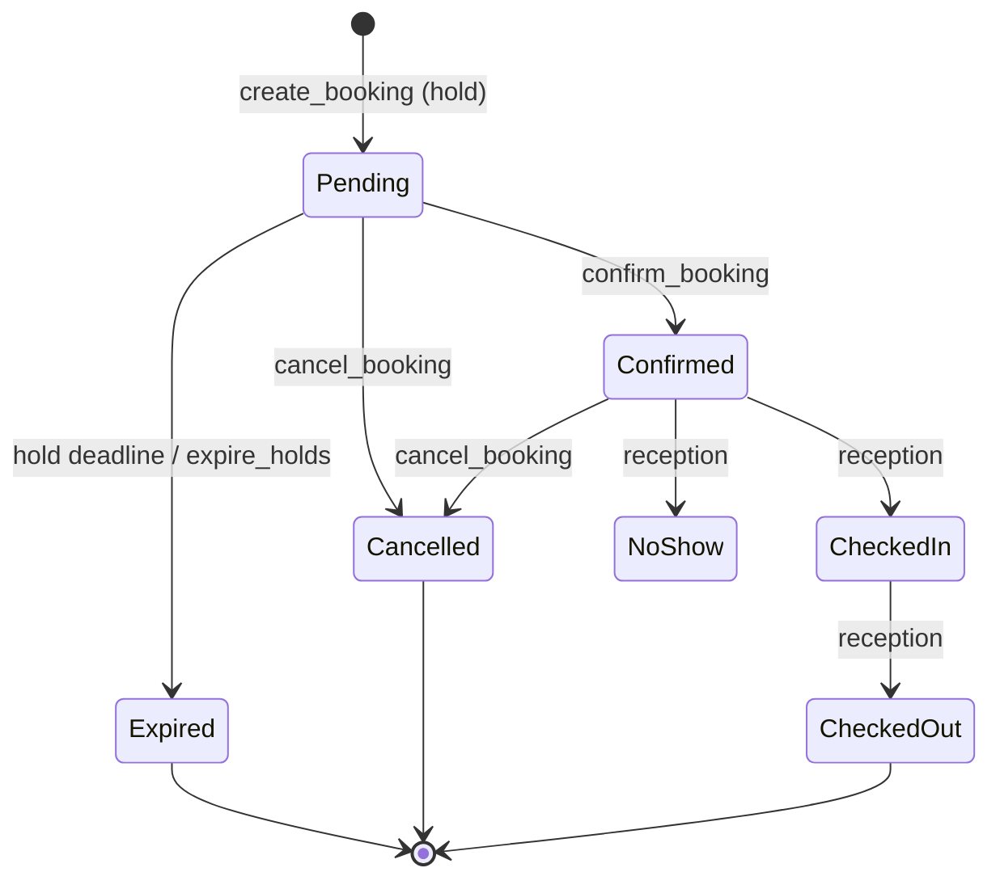
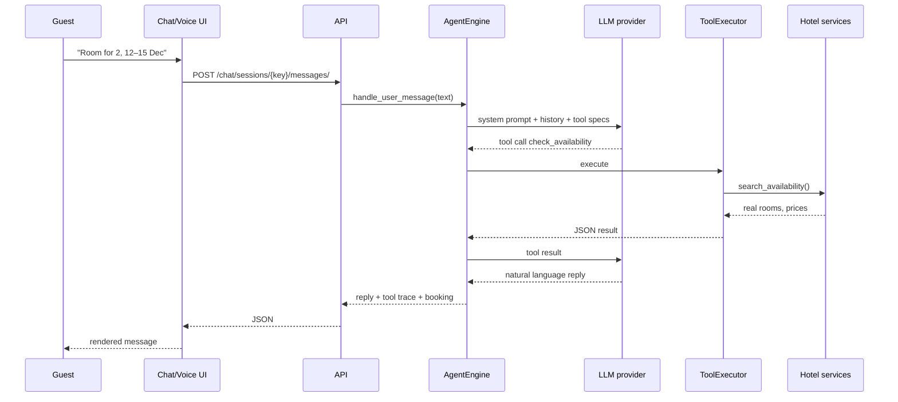

# Architecture

Hotel Aurora is a Django 5.2 application with a provider-agnostic AI conversation layer. The same domain services and tools are used by the website, the REST API, the chat concierge and the voice concierge.

## System context



The browser talks to the Django app. Chat and voice both create a `Conversation` and send user text to `POST /api/v1/chat/sessions/<key>/messages/`. The engine calls an LLM, executes tools against the hotel domain, and returns a reply plus any booking state. The web UI never decides availability or prices itself.

## Applications

| App | Responsibility |
| --- | --- |
| `apps.hotel` | Rooms, room types, clients, pricing rules, daily rates, bookings, availability, transactional booking service, cancellation policy, deposit policy, manual payment tracking/recording, audit events, signed access tokens, guest accounts/magic-link and email-verification tokens, confirmation email and SMS (including delivery history and inbound replies), admin, seed/ops commands |
| `apps.api` | DRF serializers, views, URL routing, throttling and the JSON error envelope |
| `apps.agents` | Provider-agnostic conversation engine, tool definitions/execution, prompts, provider and conversation models |
| `apps.providers` | LLM connectors (OpenAI, Anthropic, Ollama, demo) behind a shared interface |
| `apps.voice` | Speech-to-text / text-to-speech provider abstraction and browser client config |
| `apps.calendar_sync` | Calendar connections, per-room mappings, event records, fake/Google adapters, sync service |
| `apps.web` | Public Django templates, the staff operations dashboard and page views |

`apps.providers` is a plain Python package rather than a Django app: it has no models or migrations.

## Domain model



### RoomType and Room

- A **RoomType** is the sellable product: name, slug, capacity, base price, currency, size, beds, amenities.
- A **Room** is a physical unit (`101`, `102`, …) belonging to exactly one room type.
- Availability is calculated per physical room, so two bookings cannot occupy the same room on overlapping nights.

### PricingRule

Rules are applied **per night**, in priority order. Percentage adjustments are summed, fixed adjustments are added, and the result is floored at zero.

Supported kinds: seasonal, weekend, last-minute and long-stay. A rule can target one room type or all room types, can have a date window, weekday mask (`0` = Monday) and a minimum-night condition.

All amounts are **gross and VAT-inclusive**. `tax_included` is informational, derived from `HOTEL["tax_rate"]`:

```text
tax_included = subtotal * rate / (1 + rate)
```

### DailyRate (rate calendar)

`DailyRate` is one explicit row per room type and date: a nightly `rate` and an optional `min_nights`.

- A row replaces the calculated rate for that night; pricing rules are skipped for that night.
- The strictest `min_nights` across the requested nights is enforced by `quote()`. `search_availability()` omits a room type that fails the minimum stay, so the guest sees only bookable options.
- Reception edits the month grid at **Admin → Daily rates → Rate calendar**; the same model is available as ordinary rows for bulk import or API-style automation.

### Booking state machine



- A **pending** booking blocks its room until `hold_expires_at` (30 minutes by default).
- **Confirmed**, **checked-in** bookings always block the room.
- **Cancelled**, **expired** and **no-show** bookings never block.
- The booking reference is human-friendly (`HA-7KQ2M4`) and generated without ambiguous characters.
- Each booking also has a random `access_token`; guest-facing links are signed `TimestampSigner` payloads containing the reference and that token.

`apps.hotel.booking_service` is the only write path. It locks the room type row (`select_for_update`), checks capacity and availability, prices the stay, deduplicates/creates the client, validates and saves the booking, and schedules calendar sync and the confirmation email with `transaction.on_commit`. `modify_booking()` reuses the same availability and pricing code with `exclude_booking`, so a guest can move dates or room type without double-booking themselves.

Every transition appends a `BookingEvent` with the actor (`guest`, `staff`, `agent`, `system`), channel, a summary and JSON before/after data. The model rejects updates, and the admin is read-only, so the trail is append-only by construction.

### Payment tracking and deposit policy

Payment handling is manual/admin-first (no direct card/acquirer integration or automatic capture). `Booking` stores `payment_status`, `amount_paid`, `amount_due` (derived), `payment_method`, `payment_reference`, `paid_at` and `payment_notes`. `record_booking_payment()` in `apps.hotel.booking_service` is the single write path for staff payment changes (recorded/adjusted/refunded/waived): it updates the booking, derives status when not explicitly set, and appends an immutable `BookingEvent` (`payment_recorded`, `payment_adjusted`, `payment_refunded`, `payment_waived`) with before/after payment snapshots. The `record_payment` management command and the admin use this path.

`apps.hotel.deposit` `deposit_summary()` is the single source of truth for the deposit/prepayment policy: hotel-level defaults from `HOTEL["deposit_policy"]` / `HOTEL["deposit_value"]` (`DEPOSIT_POLICY=none|percent|fixed`, `DEPOSIT_VALUE`), optionally overridden per `RatePlan` (`inherit`/`none`/`percent`/`fixed`). The summary (deposit amount, amount due now, balance due and policy text) is surfaced on the guest booking page, in confirmation email/SMS, and in token-gated booking API responses. `/ops/` highlights active/pending bookings needing payment attention (unpaid or partially paid).

### Cancellation policy

`apps.hotel.cancellation` is the single source of truth for fees:

- a pending hold is always free to release;
- a confirmed booking is free while `today <= check_in - HOTEL["cancellation_free_days"]`;
- a late cancellation charges the first `HOTEL["cancellation_fee_nights"]` stored nightly rates, capped at the booking total.

`cancellation_preview()` returns the amount, currency, free-until date, reason code and a translated policy sentence. The booking page, the API preview endpoint, the agent tools and `cancel_booking()` all read that same preview; `cancel_booking()` records the fee and reason on the booking and in the audit event. `CANCELLATION_FREE_DAYS` and `CANCELLATION_FEE_NIGHTS` are environment settings.

### Booking access and notifications

- `apps.hotel.access` issues and verifies signed booking tokens, builds management URLs, and matches a reference against the email or normalised phone number on the booking.
- The API returns `manage_token` and `manage_url` on every booking response. Detail/confirm/cancel accept the token as a query parameter, `X-Booking-Token` header or Bearer token.
- The web lookup never exposes a booking from a reference alone: it redirects to a signed link only when the contact matches. Rotating `Booking.access_token` revokes every link.
- `/my-bookings/` is the web guest account area. Guests can register with email/password, verify email addresses, reset/change passwords, sign in with Google (when configured), or use a transitional single-use magic link. `apps.hotel.guest_access` stores only SHA-256 hashes for magic-link and email-verification tokens, enforces cooldowns/throttling, and resolves verified account/email linkage for booking visibility. Requests that could reveal account existence return neutral responses. A signed-in guest session can open bookings accessible through verified account linkage or matching guest email (including preserved magic-link session fallback cases), and the detail view issues that booking's normal signed token so confirm/modify/cancel keep working. Signed booking links and reference+email/phone lookup remain supported fallbacks.
- `apps.hotel.notifications` renders an English or Polish confirmation with `apps.hotel.ics` and sends it after commit. `confirmation_email_sent_at` makes retries idempotent; `send_booking_emails` retries undelivered confirmations with exponential backoff. Each send or retry appends an `EmailDelivery` row; provider webhooks update the matching row's final status. `/ops/` shows the last 20 deliveries and the admin exposes a read-only list. The same notification module renders the guest magic-link email through the configured provider.
- `apps.hotel.sms_providers` delivers a short confirmation text through a pluggable `SmsProvider`. The default `console` provider records the message in the log and `ConsoleSmsProvider.outbox` so demos and tests work offline; `twilio` posts to the Twilio Messages API when configured. `send_booking_confirmation_sms()` owns the `confirmation_sms_sent_at` marker and the status/attempt/retry fields on the booking, and appends an `SmsDelivery` row for each attempt. Failed or unsent confirmations are retried with exponential backoff by `send_booking_sms`; `/ops/` shows SMS delivery health, retries and problem deliveries.
- `apps.hotel.sms_webhooks` normalises provider delivery receipts and inbound replies. The `/api/v1/sms/webhooks/<provider>/` endpoint (optionally protected by `SMS_WEBHOOK_SECRET`) updates the booking and matching/latest `SmsDelivery` on a receipt, and stores inbound replies as `InboundSmsMessage` records (linked to a booking when the sender phone can be matched). `/ops/` and the admin expose SMS delivery history and inbound replies as read-only staff views.
- Email, SMS and calendar failures are logged and never roll back a reservation.

### Availability

`available_rooms()` excludes rooms with overlapping blocking bookings:

```text
booking.check_in < requested.check_out AND booking.check_out > requested.check_in
```

A pending booking counts only while `hold_expires_at` is null or in the future. `search_availability()` returns one entry per eligible room type with remaining rooms, room numbers and a full quote. A rate-calendar minimum stay longer than the requested range removes that room type from the result instead of raising for the whole search.

### Operations dashboard

`/ops/` is a staff-only page (`staff_member_required`) that answers "what needs attention at the start of the shift?" in one view: today's arrivals and departures, active holds, expired holds waiting for cleanup, failed calendar syncs, confirmed bookings whose confirmation email has no delivery marker, and the most recent `BookingEvent` rows. It reads the same domain tables as the admin; it does not introduce another write path.

## AI conversation layer



### Provider abstraction

`apps/providers/base.py` defines the shared shapes:

- `ChatMessage` (role, content, tool calls, tool-call id, name)
- `ToolCall` (id, name, arguments)
- `ToolSpec` (name, description, JSON Schema)
- `LLMResponse` (content, tool calls, usage, model, provider)
- `LLMProvider` (`chat()`, `health_check()`)

Each connector translates to and from its vendor format. `resolve_provider()` selects the active default `AIProvider` and falls back to the demo policy if the configured provider is unusable. API keys are stored in an `EncryptedCharField`, so the model reads plaintext while SQLite holds Fernet ciphertext. This fallback is deliberate: a missing key must not break the reception desk.

### Tools

The model can only affect the world through these tools:

| Tool | Effect |
| --- | --- |
| `check_availability` | Read-only availability search |
| `get_pricing` | Read-only nightly breakdown |
| `create_booking` | Create a pending hold and attach it to the conversation |
| `confirm_booking` | Confirm a hold |
| `get_booking` | Read a booking by reference |
| `cancel_booking` | Cancel a booking, with an optional reason and note |
| `send_confirmation_email` | Send or resend the confirmation email, optionally storing an address |
| `send_confirmation_sms` | Send a short confirmation SMS, optionally storing a phone number |
| `transfer_to_human` | Record a handover request for a receptionist |

Tool handlers are defensive: invalid arguments and domain errors become `{"ok": false, "error": ...}` results instead of exceptions, so the model can recover in the next turn.

The engine stores every user, assistant and tool message. `conversation_history()` exposes only user/assistant messages to the UI. A tool loop is capped by `AgentSettings.max_tool_iterations` (6 by default) to avoid runaway calls.

### Prompts and settings

`AgentSettings` is a singleton (`pk=1`) holding:

- assistant name, enabled flags for chat/voice;
- English and Polish system prompts, greetings and fallbacks;
- default provider, tool-iteration limit, hold duration;
- STT/TTS provider names and voice names.

The system prompt is assembled at request time with runtime context: hotel name, today's date, currency, check-in/out times, hold duration, channel and active room types. The guest language is appended as an explicit instruction. The default language is Polish; the engine detects an explicit request for English (or Polish) before each turn and updates `conversation.language`, so the prompt and the demo policy reply in the chosen language.

## Voice

`apps.voice.providers` defines `BaseSTTProvider` and `BaseTTSProvider`.

- **Browser** (default): the page uses `SpeechRecognition` and `speechSynthesis`. No audio leaves the browser.
- **OpenAI**: `OpenAISTTProvider` posts audio to `/audio/transcriptions`; `OpenAITTSProvider` posts text to `/audio/speech`.

`GET /api/v1/voice/config/` tells the browser which mode to use, the available languages (`en-US`, `pl-PL`), greeting text and voice names. The voice page reuses the chat session/message endpoints, so business logic is identical across channels.

## Calendar sync

The design target is **one Google Calendar per room**.

- `CalendarConnection` stores the provider (`google` or `fake`), default calendar id, credentials JSON and sync flags.
- `RoomCalendar` is a one-to-one mapping from a room to a calendar id.
- `BookingCalendarEvent` is the idempotency record: one per booking + mapping, with `pending` / `synced` / `failed` / `deleted`, the external event id and the last payload.

Sync runs after commit:

1. `confirm_booking()` / `cancel_booking()` register `transaction.on_commit`.
2. `sync_booking()` finds the room mapping and skips when absent or disabled.
3. Pending bookings are not synced.
4. Confirmed/checked-in bookings are created or updated; cancelled/expired/no-show events are deleted.
5. Errors are persisted, never raised into the booking flow.
6. `sync_calendars --retry-failed` retries failed records.
7. `reconcile_calendars` compares the stored event with the provider (summary, location, dates and status), reports drift and repairs it with `--apply`: recreate missing events, update edited ones, retry failed syncs and delete events for cancelled bookings.

Google credentials can come from the connection's `credentials_json` or from `GOOGLE_CALENDAR_CREDENTIALS_FILE`. Service accounts and authorised-user OAuth tokens are both accepted. The fake provider keeps events in a class-level store so tests can exercise reconciliation without Google; `tests/conftest.py` resets it between tests.

## Internationalisation

- Django `LocaleMiddleware` with `en` and `pl`.
- `LANGUAGES` drives the language switcher in `base.html`.
- Templates use `` / ``.
- Python domain errors use `gettext` / `gettext_lazy`.
- `locale/pl/LC_MESSAGES/django.po` + `.mo` provide Polish.
- `scripts/update_translations.py` extracts strings without GNU gettext; `scripts/pl_translations.py` is the translation dictionary; `scripts/compile_translations.py` writes the binary catalogue.
- Chat/voice UI strings are passed to JavaScript through `data-msg-*` attributes and inline i18n JSON, so the JS stays translation-aware without a build step.

## Settings and deployment

| Settings module | Use |
| --- | --- |
| `config.settings.base` | Shared configuration, env parsing, apps, middleware, DB, i18n, logging |
| `config.settings.dev` | `DEBUG=True`, permissive hosts, browsable API |
| `config.settings.prod` | `DEBUG=False`, WhiteNoise compressed manifest storage, optional TLS/HSTS |
| `config.settings.test` | In-memory SQLite, fast hashing, no throttling, fake calendar, locmem email |

Docker uses `config.settings.prod`. Gunicorn serves the WSGI app; WhiteNoise serves hashed static files. SQLite is stored in the `hotel_data` volume. The entrypoint runs migrations, creates the database cache table and collects static files. A `scheduler` sidecar runs `expire_holds`, `reconcile_calendars --apply`, `send_booking_emails` and `send_booking_sms` every five minutes. The health endpoint checks the database with `SELECT 1`.

### Security posture

Implemented: CSRF, clickjacking protection, HttpOnly session cookies, SameSite=Lax, optional secure cookies/HSTS, API throttling backed by the database cache, signed booking tokens, guest email/password auth with Django password validation, single-use hashed magic-link and email-verification tokens, Google OAuth sign-in with verified-email linking, guest auth anti-enumeration and cache-backed throttling/cooldowns, encrypted provider keys, append-only booking and payment audit events, no card data collection or direct payment processing.

Deliberately out of scope for the alpha: card/acquirer integration and automatic capture, virus scanning of uploads, multi-factor admin, rate limiting at the proxy, external secret management.

## Extension points

- Add a channel by creating a `Conversation` with a new channel value and reusing the message endpoint.
- Add an LLM vendor by implementing `LLMProvider` and registering it in `apps/providers/registry.py`.
- Add a speech vendor by implementing `BaseSTTProvider` / `BaseTTSProvider` and extending the factories.
- Add a calendar vendor by implementing the calendar provider interface and adding a `CalendarConnection.Provider` choice.
- Add a pricing dimension by extending `PricingRule` and `applies_to()` / `adjust()`.
- Add a tool by adding a `TOOL_SPECS` entry and a `_tool_*` handler in `apps/agents/tools.py`.
