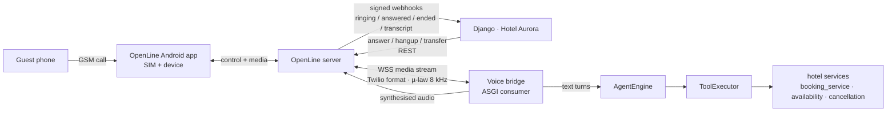

# OpenLine phone voice integration

**Status:** planned — v0.11.0 track
**Branch:** `feature/v0.11.0-openline-integration`
**Last updated:** 2026-11-21

This document is the feature roadmap and task plan for answering real phone calls through the vendored `django-openline` app and the existing agent/booking flow. It is a plan, not a commitment: Phase 0 exists to confirm the parts of the OpenLine API that its README marks as assumed.

## 1. Goal

Let a guest call the hotel's OpenLine number, talk to the same AI receptionist that serves chat and the browser voice page, and complete the normal availability → hold → confirmation flow. The phone becomes another transport for the existing conversation engine, not a second booking system.

**Success looks like:**

- An inbound call is answered within two rings and hears a greeting in under 1.5 s.
- A guest can check availability, get a price, create a hold, confirm a booking and choose SMS or email confirmation entirely by voice, in Polish and English.
- Every call produces one `Conversation` and one `PhoneCall`, with the transcript and tool trace available to staff.
- A caller can be transferred to a human without losing the booking context.
- A failure in STT, TTS, the LLM or OpenLine degrades to a clear message or a transfer; it never leaves a call stuck or writes booking state outside `booking_service`.
- The existing chat, browser voice, API, admin and ops behaviour is unchanged when the feature is off.

**Non-goals:** replacing chat/browser voice, building a call centre, multi-property tenancy, or storing card data over the phone.

## 2. What exists today

| Area | Current state | Relevance |
| --- | --- | --- |
| `django-openline` | REST client, signed webhook inbox with de-duplication, `Call`/`WebhookEvent`, admin, `openline_check`/`openline_call`/`openline_prune`. Mounted at `/integrations/openline/webhook/`. | Control plane only. It does **not** host the agent or audio side. |
| `apps.agents.engine` | `start_conversation()` and `AgentEngine.handle_user_message(text) -> AgentTurn`; provider-agnostic, persists `Message` rows, detects language. | The reusable brain. Phone should call this, not a copy. |
| `apps.agents.tools` | `check_availability`, `get_pricing`, `create_booking`, `confirm_booking`, `get_booking`, `cancel_booking`, `send_confirmation_email`, `send_confirmation_sms`, `transfer_to_human`. | Reuse unchanged. `transfer_to_human` currently only returns text. |
| `apps.voice.providers` | `BaseSTTProvider` / `BaseTTSProvider`; browser and OpenAI request/response implementations. | Needs streaming/chunked adapters and audio conversion. |
| `Conversation` | Channels are `chat` and `voice`; stores `language`, `client`, `booking`, `provider`, `state`. | Needs a `phone` channel and a call link. |
| Deployment | Gunicorn WSGI, no Channels/Redis, `config/asgi.py` is a placeholder, `docker-compose.yml` has `web` + `scheduler`. | Needs an ASGI runtime and a channel layer, or a separate bridge service. |
| Booking invariants | Single write path `booking_service`, per-room availability, append-only `BookingEvent`, after-commit email/SMS/calendar. | Must hold for phone calls without exception. |

## 3. Gap analysis

| Gap | What is missing |
| --- | --- |
| Media transport | No WebSocket endpoint for the OpenLine media stream (Twilio format, µ-law 8 kHz). |
| Audio conversion | No µ-law encode/decode, resampling, frame pacing or jitter handling. |
| Turn detection | No VAD or endpointing; the browser relies on `SpeechRecognition` end-of-utterance. |
| Streaming speech | STT/TTS are request/response; phone needs low-latency streaming or small chunking. |
| Telephony state | No phone channel, no call record, no idempotent call lifecycle. |
| Caller identity | No E.164 normalisation or phone → `Client` resolution. |
| Barge-in | No way to stop playback when the caller speaks. |
| Human transfer | `transfer_to_human` has no telephony action. |
| Consent | No AI disclosure or recording notice for calls. |
| Operations | No call metrics, latency traces, cost guardrails or runbook. |

## 4. Target architecture

### Component responsibilities

| Component | Owns |
| --- | --- |
| OpenLine app | Call control, signed webhook verification, `Call`/`WebhookEvent` storage. No agent logic. |
| `apps.voice.telephony` (new) | Map OpenLine events to `PhoneCall` + `Conversation`; answer/hangup/transfer; idempotency. |
| Voice bridge (new) | WebSocket lifecycle, audio codec, VAD, STT/TTS orchestration, barge-in, turn loop. |
| `apps.agents` | Prompt, tool loop, language switching, persistence. Unchanged except phone prompt/settings. |
| `apps.hotel` | Booking, availability, pricing, cancellation. Unchanged. |

### Options considered

| Option | Pros | Cons |
| --- | --- | --- |
| **A. Django Channels + Redis in the existing deployment** | One deploy, direct ORM access, reuses Django auth/settings, smallest operational surface. | Adds Redis and an ASGI server; a long-lived consumer competes with web workers unless scaled separately. |
| **B. Separate ASGI voice-bridge service** (Pipecat/LiveKit/FastAPI) | Isolates CPU/audio load, independent scaling, mature audio tooling. | Second deploy, second config surface, cross-service auth and DB access, more moving parts for an alpha. |
| **C. Managed voice platform** | Least audio code to own. | Vendor lock-in, cost, data residency and consent questions, duplicates the agent/tool layer. |

**Recommendation:** start with **A**, behind a `VoiceSession` seam so B remains a swap rather than a rewrite. Phase 0 spikes both A and B just far enough to measure latency and confirm the stream contract; the ADR records the decision.

### Turn loop

1. OpenLine opens the media stream; the bridge validates the call id against `PhoneCall`.
2. Caller audio frames are decoded and buffered; VAD marks speech start/end.
3. On end-of-utterance, audio is transcribed (streaming partials where available).
4. The transcript goes to `AgentEngine.handle_user_message()`.
5. Tool calls run against the existing services; a short filler or hold phrase covers slow tools.
6. The reply is synthesised, chunked and streamed back; playback stops immediately on barge-in.
7. `Message` rows and the transcript are persisted; the call ends on hangup, silence timeout or max duration.

## 5. Data model changes

### `Conversation`

- Add `Channel.PHONE = "phone"` (`max_length` already fits).
- Migration: `agents.0005_alter_conversation_channel`.
- `start_conversation(channel="phone")` must honour a new `AgentSettings.phone_enabled` flag.

### `PhoneCall` (new, `apps/voice/models.py`)

Keep telephony state in the domain app, keyed by the provider's id, so swapping OpenLine does not leak into `agents`.

| Field | Type | Purpose |
| --- | --- | --- |
| `conversation` | FK `agents.Conversation`, `SET_NULL`, nullable | Link to the dialogue. |
| `provider` | `CharField` default `"openline"` | Future-proofing. |
| `external_id` | `CharField(unique=True)` | OpenLine call id; idempotency key. |
| `direction` | `inbound` / `outbound` | Reporting and prompt context. |
| `from_number`, `to_number` | `CharField` | E.164, normalised. |
| `status` | `ringing` / `answered` / `ended` / `failed` / `transferred` | Lifecycle. |
| `started_at`, `answered_at`, `ended_at` | datetimes | Timing and SLA metrics. |
| `duration_seconds` | `PositiveIntegerField` | Cost and reporting. |
| `recording_url` | `URLField` blank | Only when recording is enabled and consented. |
| `transcript` | `JSONField` | Ordered turns with timestamps. |
| `summary` | `TextField` blank | Optional post-call summary. |
| `metadata` | `JSONField` | Latency samples, provider payload, cost estimate. |

Add read-only admin and an `/ops/` tile (calls today, answer rate, average duration, failures). No new write path.

### `AgentSettings`

| Field | Default | Purpose |
| --- | --- | --- |
| `phone_enabled` | `False` | Feature flag, off until the pilot. |
| `phone_greeting_pl` / `phone_greeting_en` | short greeting + AI disclosure | Spoken opening. |
| `phone_consent_message_pl` / `phone_consent_message_en` | recording/AI notice | Played before capture when required. |
| `phone_max_seconds` | `900` | Hard cap per call. |
| `phone_transfer_number` | blank | Human fallback / `transfer_to_human`. |
| `phone_silence_timeout_seconds` | `20` | Reprompt then transfer. |

Migrations: `agents.0006_agentsettings_phone_fields`, `voice.0001_initial` (the app currently has no models or migrations package).

## 6. Configuration

| Variable | Default | Notes |
| --- | --- | --- |
| `VOICE_PHONE_ENABLED` | `false` | Master switch; also reflected in `AgentSettings`. |
| `OPENLINE_DEFAULT_DEVICE_ID` | empty | Existing; the SIM/device that answers. |
| `OPENLINE_DEFAULT_STREAM_URL` | empty | Set to the public `wss://…/ws/voice/openline/`. |
| `OPENLINE_DEFAULT_STREAM_FORMAT` | `twilio` | Confirmed by the OpenLine README. |
| `VOICE_PUBLIC_WSS_URL` | empty | Used when placing outbound calls. |
| `VOICE_STT_PROVIDER` | `openai` | Phone cannot use the browser provider. |
| `VOICE_TTS_PROVIDER` | `openai` | Same. |
| `VOICE_STT_MODEL`, `VOICE_TTS_MODEL`, `VOICE_TTS_VOICE` | provider defaults | Quality/latency tuning. |
| `VOICE_MAX_CONCURRENT_CALLS` | `2` | Protects the pilot line and the LLM budget. |
| `VOICE_MAX_MINUTES_PER_DAY` | `120` | Cost guardrail; alert before the cap. |
| `REDIS_URL` | empty | Only for option A. |
| `CHANNEL_LAYERS` | in-memory in tests | Redis in production. |

All new settings are optional: an install that never enables phone keeps the current behaviour and a clean `manage.py check`.

## 7. Work breakdown

Each phase ends with the full gate: `pytest`, `manage.py check`, `makemigrations --check`, `ruff check .`. Phases are independently shippable behind the flag.

### Phase 0 — Validate the contract and choose the runtime (2–3 days)

- [ ] Run `manage.py openline_check` against a real OpenLine server; record which endpoints and headers actually work.
- [ ] Capture real webhook payloads for `ringing`, `answered`, `ended` and any transcript event.
- [ ] Capture the media stream handshake and frame shapes (`connected`, `start`, `media`, `mark`, `stop`).
- [ ] Spike A: minimal Channels consumer that echoes µ-law frames back.
- [ ] Spike B: standalone ASGI bridge with the same echo behaviour.
- [ ] Measure round-trip latency for both with fake STT/TTS.
- [ ] Write an ADR: runtime choice, stream format, endpoint overrides, known unknowns.

**Acceptance:** one real inbound call reaches a local `wss://` endpoint and audio round-trips; the ADR is committed.

### Phase 1 — Telephony control plane (3–4 days)

- [ ] Add `Conversation.Channel.PHONE` and the `PhoneCall` model with migrations.
- [ ] Implement `apps/voice/telephony.py`: create/update `PhoneCall` and `Conversation` from OpenLine events, idempotent on `external_id`.
- [ ] Register `@on_event(...)` handlers from `apps/voice/apps.py` `ready()`; keep handlers import-safe.
- [ ] Answer inbound calls and hang up through the OpenLine client; handle answer/reject failures.
- [ ] Support outbound callbacks with `place_call(..., stream_url=...)`.
- [ ] Resolve callers to `Client` by normalised E.164 without treating the number as authentication.
- [ ] Add read-only admin and an `/ops/` call tile.
- [ ] Tests: duplicate webhooks, out-of-order events, unknown call id, provider errors.

**Acceptance:** a real call creates exactly one `PhoneCall` and one `Conversation`; retries do not duplicate; status transitions are correct; `/ops/` shows the call.

### Phase 2 — Media pipeline (5–7 days)

- [ ] Add the chosen runtime dependencies (Channels + `channels-redis` for A, or the bridge stack for B).
- [ ] Route `/ws/voice/openline/`; reject unknown or disabled calls.
- [ ] Implement Twilio-format framing: base64 µ-law 8 kHz in, paced 20 ms frames out.
- [ ] Convert 8 kHz µ-law ↔ 16 kHz PCM for the speech providers.
- [ ] Add VAD/endpointing with configurable silence thresholds; no fixed-duration cuts.
- [ ] Implement streaming STT with partial transcripts; fall back to chunked REST.
- [ ] Implement TTS with sentence chunking and streaming playback.
- [ ] Implement barge-in: stop queued audio on speech start and discard stale chunks.
- [ ] Add silence reprompt, max duration, hangup and error frames.
- [ ] Build a fake media harness with WAV fixtures; test codec round-trips and the consumer.
- [ ] Record p50/p95 turn latency and add a latency log line per turn.

**Acceptance:** a scripted call produces a transcript and an audible reply; barge-in stops playback; p95 turn latency is inside the budget in section 8 on a local run.

### Phase 3 — Conversation and tools on the phone (4–5 days)

- [ ] Add `PhoneAgentSession` that wraps `AgentEngine` with the phone prompt and call context.
- [ ] Write phone prompts: short spoken sentences, dates and prices read naturally, references spelled out, no markdown.
- [ ] Play greeting + AI disclosure, then detect Polish/English from the first utterance and allow an explicit switch.
- [ ] Cover slow tools with a filler/hold phrase; never leave silence longer than the budget.
- [ ] Reuse every booking tool unchanged; verify holds, confirmation, cancellation and `send_confirmation_sms`/`email`.
- [ ] Turn `transfer_to_human` into a real warm/cold transfer using `phone_transfer_number`.
- [ ] Recognise returning callers by number for convenience only; require reference + email/phone for changes, matching `apps/hotel/access.py`.
- [ ] Support DTMF as a fallback for references and phone numbers.
- [ ] Persist the transcript, tool trace and call summary.
- [ ] Tests: full availability → hold → confirm over fake audio in PL and EN, plus cancellation and transfer.

**Acceptance:** a complete booking by phone with the demo provider writes through `booking_service`, sends the chosen confirmation, and leaves a readable transcript. No booking logic is duplicated.

### Phase 4 — Safety, compliance and operations (3–4 days)

- [ ] Add configurable AI disclosure and recording notice in PL/EN; do not record without consent.
- [ ] Add opt-out and do-not-record handling; document retention.
- [ ] Redact phone numbers, emails and references from logs; cap `WebhookEvent`/payload retention.
- [ ] Add per-caller throttling and a concurrent-call cap.
- [ ] Add daily minute/cost guardrails with an alert before the cap.
- [ ] Fallbacks: STT failure → transfer; LLM failure → fixed apology + transfer; TTS failure → hang up cleanly; OpenLine failure → stop answering.
- [ ] Metrics: calls, answer rate, drop rate, turn/tool latency, transfers, cost per minute, errors.
- [ ] Structured logs keyed by call id; no raw audio in logs.
- [ ] Write the runbook: enable, disable, test call, common failures, rollback.

**Acceptance:** injected STT/LLM/TTS/OpenLine failures end in a transfer or a clean hangup, never a stuck call; metrics and the runbook exist.

### Phase 5 — Pilot and release (3–5 days)

- [ ] Ship behind `VOICE_PHONE_ENABLED=false` and `AgentSettings.phone_enabled=False`.
- [ ] Configure a pilot number and an allowlist of test callers.
- [ ] Evaluate PL/EN quality with real callers; record WER and comprehension notes.
- [ ] Load-test the target concurrency and confirm the latency budget.
- [ ] Update `README.md`, `docs/ARCHITECTURE.md`, `docs/API.md`, `docs/PROJECT_MEMORY.md` and `docs/releases/v0.11.0.md`.
- [ ] Test rollback: clear the stream URL / disable the flag; confirm calls stop cleanly.
- [ ] Release v0.11.0 through the normal branch → PR → `main` → tag → back-merge flow.

**Acceptance:** pilot calls book, confirm and transfer successfully; rollback is proven; the full gate and CI are green.

## 8. Budgets

| Metric | Target |
| --- | --- |
| Time to first greeting | ≤ 1.5 s after answer |
| End-of-speech → first reply audio (p50 / p95) | ≤ 800 ms / ≤ 1.5 s |
| Barge-in stop | ≤ 300 ms |
| Tool call with filler | No silence > 2 s |
| ASR word error rate (PL / EN, quiet) | ≤ 15% / ≤ 10% |
| Dropped calls (non-caller) | < 2% in the pilot |
| Concurrent calls on the pilot host | ≥ 2 with headroom |

These are starting targets; Phase 2 records the real numbers and Phase 5 revises them.

## 9. Testing strategy

- **Unit:** µ-law codec, resampling, frame pacing, VAD thresholds, event → `PhoneCall` mapping, phone prompt formatting.
- **Integration:** signed webhook → `PhoneCall`/`Conversation`; consumer with fake audio; `AgentEngine` + demo provider through the phone session; transfer and failure paths.
- **Contract:** duplicate and out-of-order webhooks, invalid signature, unknown call id, OpenLine timeouts.
- **End-to-end (offline):** a scripted WAV call that checks availability, holds and confirms a booking in PL and EN.
- **Manual:** real calls on the pilot number, including background noise, interruptions and a human transfer.
- **CI:** no real telephony or paid STT/TTS; fakes only. The existing 391-test suite must stay green.

## 10. Risks and mitigations

| Risk | Impact | Mitigation |
| --- | --- | --- |
| OpenLine API details are partly assumed | Integration rework | Phase 0 confirms endpoints, headers and payloads against a real server; `OPENLINE["ENDPOINTS"]` overrides. |
| Streaming latency too high | Callers talk over the agent | Measure in Phase 0/2; chunk TTS, cap tool time with fillers, keep the prompt short. |
| Polish STT quality | Misunderstood dates and names | Evaluate providers in Phase 0; confirm critical values back; DTMF fallback. |
| Telephony/LLM cost | Surprise bill | Minute caps, concurrency cap, per-call cost estimate, alert. |
| Consent/recording law | Compliance exposure | Disclosure before capture, opt-out, retention policy, legal review before the pilot. |
| ASGI/Redis operational load | New failure mode | Isolate the consumer, health checks, rollback to flag-off, option B seam. |
| Caller identity misuse | Unauthorised changes | Number is convenience only; changes require reference + email/phone per `access.py`. |
| Booking invariants drift | Data corruption | All writes through `booking_service`; tools unchanged; tests assert the single write path. |
| Long-lived consumer vs WSGI workers | Resource contention | Separate ASGI service/worker in the compose stack; do not run media in gunicorn workers. |

## 11. Rollout

1. **Dark:** code and migrations merged with both flags off; no stream URL configured.
2. **Internal:** allowlisted numbers, test calls, metrics and transcripts reviewed.
3. **Pilot:** one public number during staffed hours, human transfer always available.
4. **General:** enable `phone_enabled`, publish the number, keep chat/browser voice unchanged.
5. **Rollback:** set `VOICE_PHONE_ENABLED=false` and clear `OPENLINE_DEFAULT_STREAM_URL`; calls stop being attached and the existing webhook inbox keeps recording events. No migration rollback is required.

## 12. Out of scope

- WhatsApp/SMS conversational bots and an IVR menu tree.
- Languages beyond Polish and English.
- Long-term call recording storage or analytics beyond the transcript/summary.
- Card payments over the phone (PCI-sensitive).
- Multi-property routing and a full call centre (queues, agent desktops, SLAs).
- Replacing or hosting the OpenLine server itself.

## 13. Decisions needed before Phase 1

- Runtime: option A (Channels + Redis) or option B (separate bridge), based on the Phase 0 latency spike.
- STT/TTS vendor and whether streaming is available for Polish; fallback behaviour if not.
- Recording policy: none, consent-based, or always with disclosure; retention period.
- Transfer target and staffed hours; what happens outside them.
- Who owns the telephony SIM/contract and the monthly minute budget.
- Legal review of the AI disclosure and recording wording in PL and EN.

## 14. Definition of done

- [ ] `Conversation.Channel.PHONE` and `PhoneCall` shipped with migrations and read-only admin.
- [ ] Inbound and outbound calls work through OpenLine with idempotent lifecycle handling.
- [ ] A guest can complete availability → hold → confirm → SMS/email by voice in PL and EN.
- [ ] Human transfer works and carries context.
- [ ] Consent, retention, redaction, throttling and cost guardrails are in place.
- [ ] Metrics, logs and the runbook exist; rollback is tested.
- [ ] Chat, browser voice, API and `/ops/` behaviour is unchanged when the feature is off.
- [ ] `pytest`, `manage.py check`, `makemigrations --check` and `ruff check .` are green.
- [ ] `README.md`, `docs/ARCHITECTURE.md`, `docs/API.md`, `docs/PROJECT_MEMORY.md` and `docs/releases/v0.11.0.md` are updated.
