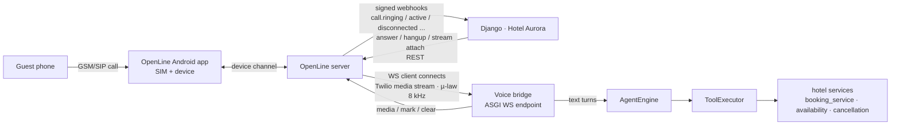

# OpenLine phone voice integration

**Status:** planned — v0.11.0 track  
**Branch:** `feature/v0.11.0-openline-integration`  
**Last updated:** 2026-11-27 (vendored OpenLine stream client/service tests added; Phase 0 real-device validation still pending)  
**Hardening:** commit `426bb00` addressed mark/silence/admission/DTMF-failure review findings in the phone bridge.

This document is the feature roadmap and task plan for answering real phone calls through the vendored `django-openline` app and the existing agent/booking flow. The OpenLine public docs confirm the main contract (signed webhooks, Twilio-format media streams, stream attach on create/answer, incoming stream settings), but Phase 0 still validates the real server, payload shapes, and latency before implementation commits to a runtime.

**References:** [OpenLine docs](https://manohar-k-reddy.github.io/openline/start/introduction/) · [Agent streams](https://manohar-k-reddy.github.io/openline/guides/agent-streams/) · [Incoming calls](https://manohar-k-reddy.github.io/openline/guides/incoming-calls/) · [Stream protocol](https://manohar-k-reddy.github.io/openline/reference/stream-protocol/) · [Webhooks](https://manohar-k-reddy.github.io/openline/guides/webhooks/) · [Call states](https://manohar-k-reddy.github.io/openline/reference/call-states/) · [llms-full.txt](https://manohar-k-reddy.github.io/openline/llms-full.txt)

## 1. Goal

Let a guest call the hotel's OpenLine number, talk to the same AI receptionist that serves chat and the browser voice page, and complete the normal availability → hold → confirmation flow. The phone becomes another transport for the existing conversation engine, not a second booking system.

**Success looks like:**

- An inbound call is answered within two rings and hears a greeting in under 1.5 s.
- A guest can check availability, get a price, create a hold, confirm a booking and choose SMS or email confirmation entirely by voice, in Polish and English.
- Every call produces one `Conversation` and one `PhoneCall`, with the transcript and tool trace available to staff.
- A caller can be transferred to a human without losing the booking context.
- A failure in STT, TTS, the LLM or OpenLine degrades to a clear message or a transfer; it never leaves a call stuck or writes booking state outside `booking_service`.
- The existing chat, browser voice, API, admin and ops behaviour is unchanged when the feature is off.

**Non-goals:** replacing chat/browser voice, building a call centre, multi-property tenancy, or storing card data over the phone.

## 2. What exists today

| Area | Current state | Relevance |
| --- | --- | --- |
| `django-openline` | Vendored REST client, signed webhook inbox with de-duplication, `Call`/`WebhookEvent`, admin, `openline_check`/`openline_call`/`openline_prune`. Mounted at `/integrations/openline/webhook/`. Client now also exposes `attach_stream`/`detach_stream`/`get_stream`; settings endpoints still unconfirmed. | Control plane and webhook audit. It does **not** host the agent or audio side. |
| OpenLine server/app (external) | Android phone + OpenLine server provide real SIM calls, REST call control, signed webhooks (`eventId`, retries), and Twilio-format media streams. OpenLine connects **as a WebSocket client** to the configured `stream.url` when a call is answered; closing the socket hangs up. | Confirmed transport contract; real-server validation still required in Phase 0. |
| `apps.agents.engine` | `start_conversation()` and `AgentEngine.handle_user_message(text) -> AgentTurn`; provider-agnostic, persists `Message` rows, detects language. | The reusable brain. Phone should call this, not a copy. |
| `apps.agents.tools` | `check_availability`, `get_pricing`, `create_booking`, `confirm_booking`, `get_booking`, `cancel_booking`, `send_confirmation_email`, `send_confirmation_sms`, `transfer_to_human`. | Reuse unchanged. `transfer_to_human` currently only returns text. |
| `apps.voice.providers` | `BaseSTTProvider` / `BaseTTSProvider`; browser and OpenAI request/response implementations. | Needs phone-capable STT/TTS adapters and audio conversion; browser provider cannot be used for phone. |
| `Conversation` | Channels are `chat`, `voice`, and `phone`; stores `language`, `client`, `booking`, `provider`, `state`. | Phone channel added; `PhoneCall` links telephony lifecycle to conversation. |
| Deployment | ASGI app now routes `/ws/voice/openline/`; Dockerfile runs Daphne; `docker-compose.yml` includes Redis. Channels/Redis deps added; full production validation deferred. | Media endpoint runs on ASGI; keep media off gunicorn workers. |
| Booking invariants | Single write path `booking_service`, per-room availability, append-only `BookingEvent`, after-commit email/SMS/calendar. | Must hold for phone calls without exception. |

### 2.1 Confirmed OpenLine contract (docs)

| Area | Confirmed by docs | Plan implication |
| --- | --- | --- |
| Outbound call with stream | `POST /v1/calls` accepts `stream.url`, `stream.format` (`twilio`/`raw`), `parameters`. | Reuse `django_openline.services.place_call`/client; set `VOICE_PUBLIC_WSS_URL`. |
| Incoming handling | Global `incomingStreamUrl`/`incomingStreamFormat` answers and connects all incoming calls; or handle `call.ringing` webhook and `POST /v1/calls/{id}/stream`. | Phase 0 selects default mode; support webhook-driven mode for after-hours/screening. |
| Stream attach on live call | `POST /v1/calls/{id}/stream` attaches agent; on ringing call answers first. `GET/DELETE /v1/calls/{id}/stream` inspect/detach. | Add missing vendored client methods; detach keeps call, close WS hangs up. |
| Twilio stream protocol | WS client connects to agent; sends `connected`, `start`, `media`, `mark`, `stop`; receives `media`, `mark`, `clear`. Audio is base64 µ-law 8 kHz, 20 ms. `start` includes `callSid`, `streamSid`, `customParameters`. | Implement ASGI Twilio media server; track marks; use `clear` for barge-in. |
| Webhooks | Signed `x-openline-timestamp`/`x-openline-signature`, HMAC-SHA256 of `timestamp.body`; retries 5s/30s/2m, 4 attempts; `eventId` dedupe. | `django_openline` already verifies/stores/dedupes; add domain handlers via `webhook_received`. |
| Call lifecycle | States/events include `ringing`, `active`, `holding`, `ended/rejected/failed`, `disconnected`; commands async, outcomes by events. | Domain `PhoneCall` lifecycle must be idempotent and event-driven. |

## 3. Gap analysis

| Gap | What is missing |
| --- | --- |
| Media transport | No ASGI WebSocket endpoint that accepts OpenLine's Twilio-format media stream. OpenLine connects as a WS client to `stream.url`; we must host the server, validate the call, and speak the Twilio `connected/start/media/mark/stop/clear` protocol. |
| Audio conversion | No µ-law 8 kHz ↔ 16 kHz PCM conversion, 20 ms frame pacing, jitter handling, or base64 media framing. |
| Turn detection | No VAD or endpointing; the browser relies on `SpeechRecognition` end-of-utterance. |
| Streaming speech | STT/TTS are request/response; phone needs low-latency streaming or chunked synthesis with barge-in. |
| Telephony state | No phone channel, no domain call record linked to `Conversation`, no idempotent lifecycle mapping from OpenLine webhooks/events. `django_openline.Call` stores provider state but is not the agent conversation record. |
| Caller identity | No E.164 normalisation or phone → `Client` resolution; caller number must remain convenience, not auth. |
| Barge-in | No way to send `clear` and stop queued playback when the caller speaks. |
| Human transfer | `transfer_to_human` has no telephony action; OpenLine control surface for transfer/attended handoff needs Phase 0 confirmation. |
| Consent | No AI disclosure or recording notice for calls. |
| Operations | No call metrics, latency traces, cost guardrails, or runbook. |

## 4. Target architecture

### Component responsibilities

| Component | Owns |
| --- | --- |
| `django_openline` (vendored) | OpenLine REST client, webhook signature verification, de-duplicated `WebhookEvent`, provider `Call` sync, admin. No agent or audio logic. |
| `apps.voice.telephony` (new) | Map OpenLine events to domain `PhoneCall` + `Conversation`; idempotent lifecycle; answer/reject/hangup/transfer decisions; caller normalization. |
| Voice bridge (new) | ASGI WebSocket endpoint, Twilio stream parsing, audio codec, VAD, STT/TTS orchestration, barge-in, turn loop, transcript capture. |
| `apps.agents` | Prompt, tool loop, language switching, persistence. Unchanged except phone channel/prompt/settings. |
| `apps.hotel` | Booking, availability, pricing, cancellation. Unchanged. |

### Incoming call handling modes

OpenLine supports two relevant patterns; Phase 0 picks one as default and keeps the other as fallback:

| Mode | How | Use |
| --- | --- | --- |
| **Global incoming stream** | Set OpenLine `incomingStreamUrl`/`incomingStreamFormat` in server settings/console. OpenLine answers and connects every incoming call to the bridge. | Simplest receptionist default; no per-call webhook orchestration. |
| **Webhook-driven attach** | Receive `call.ringing`, decide in Django, then `POST /v1/calls/{id}/stream` (answers ringing call and attaches agent) or answer/reject. | Needed for allowlists, after-hours routing, human-first screening, or selective AI. |

### Options considered

| Option | Pros | Cons |
| --- | --- | --- |
| **A. Django ASGI + Channels/Redis in the existing deployment** | One deploy, direct ORM access, reuses Django settings/auth, smallest operational surface. | Adds Redis and an ASGI process; long-lived media consumers must not run in gunicorn WSGI workers. |
| **B. Separate ASGI voice-bridge service** (FastAPI/Pipecat/LiveKit worker) | Isolates CPU/audio load, independent scaling, can use mature telephony/voice tooling; Twilio-format stream is Pipecat-compatible. | Second deploy, second config surface, cross-service auth/DB access, more moving parts for an alpha. |
| **C. Managed voice platform** | Least audio code to own. | Vendor lock-in, cost, data residency/consent questions, duplicates the agent/tool layer, weak fit with OpenLine SIM line. |

**Recommendation:** start with **A** behind a `VoiceSession`/bridge seam so B remains a swap rather than a rewrite. Phase 0 spikes both A and B just far enough to measure latency and confirm the real OpenLine stream contract; the ADR records the decision.

### Turn loop

1. OpenLine connects to our WSS endpoint and sends `connected` then `start` (Twilio format). The bridge validates `start.callSid`/custom params against a known `PhoneCall`/`django_openline.Call`; unknown or disabled calls are closed.
2. Inbound `media` frames (base64 µ-law, 8 kHz, 20 ms) are decoded, resampled for STT, and buffered; VAD marks speech start/end.
3. On end-of-utterance, audio is transcribed (streaming partials where available; chunked fallback otherwise).
4. The transcript goes to `AgentEngine.handle_user_message()` with phone conversation context.
5. Tool calls run against existing services; a short filler or hold phrase covers slow tools. All booking writes go through `booking_service`.
6. The reply is synthesised, converted to 8 kHz µ-law, chunked into 20 ms frames, and streamed back as `media`; `mark` events track playback. On barge-in, send `clear` and discard stale audio.
7. `Message` rows, transcript, and latency/cost metadata are persisted; the call ends on hangup, silence timeout, max duration, or fatal error. Closing the WS makes OpenLine hang up; `DELETE /v1/calls/{id}/stream` detaches the agent but keeps the call.

## 5. Data model changes

### `Conversation`

- Add `Channel.PHONE = "phone"`. Confirm `channel` max_length before migration; if needed, widen in the same migration.
- Migration: `agents.0005_alter_conversation_channel` (or next available).
- `start_conversation(channel="phone")` must honour `AgentSettings.phone_enabled`.

### `PhoneCall` (new, `apps/voice/models.py`)

Domain call record keyed by provider call id. It links the telephony lifecycle to a `Conversation` without duplicating booking logic. `django_openline.Call` remains the provider webhook/audit record; `PhoneCall.external_id` corresponds to `openline.Call.openline_id`.

| Field | Type | Purpose |
| --- | --- | --- |
| `conversation` | FK `agents.Conversation`, `SET_NULL`, nullable | Link to the dialogue. |
| `provider` | `CharField` default `"openline"` | Future-proofing. |
| `external_id` | `CharField(unique=True)` | OpenLine call id; idempotency key. |
| `direction` | `inbound` / `outbound` | Reporting and prompt context. |
| `from_number`, `to_number` | `CharField` | E.164, normalised. |
| `status` | `ringing` / `answered` / `active` / `ended` / `failed` / `transferred` | Domain lifecycle; mapped from OpenLine states/events. |
| `started_at`, `answered_at`, `ended_at` | datetimes | Timing and SLA metrics. |
| `duration_seconds` | `PositiveIntegerField`, null/blank | Cost and reporting. |
| `recording_url` | `URLField` blank | Only when recording is enabled and consented. |
| `transcript` | `JSONField` default list | Ordered turns with timestamps, speaker, tool trace refs. |
| `summary` | `TextField` blank | Optional post-call summary. |
| `metadata` | `JSONField` default dict | Latency samples, provider payload excerpts, cost estimate, stream status. |

Add read-only admin and an `/ops/` tile (calls today, answer rate, average duration, failures). No new write path.

### `AgentSettings`

| Field | Default | Purpose |
| --- | --- | --- |
| `phone_enabled` | `False` | Feature flag, off until the pilot. |
| `phone_greeting_pl` / `phone_greeting_en` | short greeting + AI disclosure | Spoken opening. |
| `phone_consent_message_pl` / `phone_consent_message_en` | recording/AI notice | Played before capture when required. |
| `phone_max_seconds` | `900` | Hard cap per call. |
| `phone_transfer_number` | blank | Human fallback / `transfer_to_human`. |
| `phone_silence_timeout_seconds` | `20` | Reprompt then transfer. |

Migrations: `agents.0006_agentsettings_phone_fields`, `voice.0001_initial` (the app currently has no models or migrations package).

## 6. Configuration

| Variable | Default | Notes |
| --- | --- | --- |
| `VOICE_PHONE_ENABLED` | `false` | Master switch; also reflected in `AgentSettings`. |
| `OPENLINE_DEFAULT_DEVICE_ID` | empty | Existing; the SIM/device that answers outbound calls. |
| `OPENLINE_DEFAULT_STREAM_URL` | empty | Public `wss://…/ws/voice/openline/` for outbound calls and/or default OpenLine stream config. |
| `OPENLINE_DEFAULT_STREAM_FORMAT` | `twilio` | Confirmed by OpenLine docs. |
| `OPENLINE_INCOMING_STREAM_MODE` | `webhook_attach` | Planned: `global` (set OpenLine server incoming stream URL) or `webhook_attach` (handle `call.ringing` and attach). Final default decided in Phase 0. |
| `VOICE_PUBLIC_WSS_URL` | empty | Public WSS base used to build/validate stream URLs. |
| `VOICE_STT_PROVIDER` | `openai` | Phone cannot use the browser provider. |
| `VOICE_TTS_PROVIDER` | `openai` | Same. |
| `VOICE_STT_MODEL`, `VOICE_TTS_MODEL`, `VOICE_TTS_VOICE` | provider defaults | Quality/latency tuning. |
| `VOICE_MAX_CONCURRENT_CALLS` | `2` | Protects the pilot line and the LLM budget. |
| `VOICE_MAX_MINUTES_PER_DAY` | `120` | Cost guardrail; alert before the cap. |
| `REDIS_URL` | empty | Only for option A. |
| `CHANNEL_LAYERS` | in-memory in tests | Redis in production for option A. |

All new settings are optional: an install that never enables phone keeps the current behaviour and a clean `manage.py check`.

## 7. Work breakdown

Each phase ends with the full gate: `pytest`, `manage.py check`, `makemigrations --check`, `ruff check .`. Phases are independently shippable behind the flag.

### Phase 0 — Validate the contract and choose the runtime (2–3 days)

- [ ] Run `manage.py openline_check` against a real OpenLine server; record which endpoints and headers actually work. Confirm/create missing vendored client methods for `POST /v1/calls/{id}/stream`, `GET/DELETE /v1/calls/{id}/stream`, and settings if needed.
- [ ] Capture real signed webhook payloads for `call.ringing`, `call.active`/`call.answered` equivalent, `call.disconnected`/`call.ended`, and any transcript event. Verify `eventId`, `occurredAt`, call `state`, and signature headers match docs.
- [ ] Capture the real Twilio-format media stream handshake and frame shapes (`connected`, `start`, `media`, `mark`, `stop`, `clear`) on a public `wss://` endpoint. Confirm `start.callSid`/`customParameters` mapping.
- [ ] Decide default inbound mode: global `incomingStreamUrl` vs webhook-driven `POST /v1/calls/{id}/stream`. Document after-hours/staffed-hours fallback.
- [ ] Spike A: minimal Django ASGI/Channels consumer that echoes µ-law frames back.
- [ ] Spike B: standalone ASGI bridge with the same echo behaviour (Pipecat/FastAPI acceptable for spike only).
- [ ] Measure round-trip latency for both with fake STT/TTS and 20 ms pacing.
- [ ] Write an ADR: runtime choice, inbound mode, stream format, endpoint overrides, known unknowns.

**Acceptance:** one real inbound call reaches a local `wss://` endpoint and audio round-trips; real webhook/stream samples are captured (redacted) in docs/tests fixtures; the ADR is committed.

### Phase 1 — Telephony control plane (3–4 days)

- [x] Add missing OpenLine client/service methods needed by the plan: `attach_stream`, `detach_stream`, `get_stream` (and settings endpoints only if required by the chosen inbound mode). Vendored stream client/service tests added in `django-openline/django-openline/tests/` (fake local HTTP server covers client method/path/body/auth/param escaping/errors; mocked-client service tests cover delegation/default format).
- [x] Add `Conversation.Channel.PHONE` and the `PhoneCall` model with migrations. Create `apps/voice/migrations/` package.
- [x] Implement `apps/voice/telephony.py`: create/update `PhoneCall` and `Conversation` from `django_openline.webhook_received` events, idempotent on `external_id`. Map confirmed OpenLine states/events (`ringing`, `active`, `holding`, `ended`, `rejected`, `failed`, `disconnected`) into the domain lifecycle. Late terminal webhooks do not overwrite `TRANSFERRED`; snapshot extraction includes call id variants; metadata writes avoid no-op churn. (Real payload validation/tests deferred.)
- [x] Register `@on_event(...)` handlers from `apps/voice/apps.py` `ready()`; keep handlers import-safe and side-effect free at import time.
- [x] Support default inbound mode selected by Phase 0: global incoming stream or webhook-driven `call.ringing` → `POST /v1/calls/{id}/stream`. Webhook-driven attach implemented; attach/admission are gated on both `VOICE_PHONE_ENABLED` and `AgentSettings.phone_enabled`; global mode/config validation still pending.
- [x] Support outbound callbacks with `place_call(..., stream_url=...)` and domain `PhoneCall` creation. (Service + staff-only API endpoint added; conversation is created after successful OpenLine placement to avoid orphans on provider failure; real OpenLine/outbound stream validation still pending.)
- [x] Resolve callers to `Client` by normalised E.164 without treating the number as authentication.
- [x] Add read-only admin for `PhoneCall` and an `/ops/` call tile.
- [x] Tests: duplicate webhooks, out-of-order events, unknown call id, provider errors, webhook-driven attach, idempotent `PhoneCall` creation. (Covered: idempotent/out-of-order handling, missing external id, duplicate webhook delivery, invalid JSON/non-object payload rejection, event-without-call-id storage, non-inbound attach ignore, webhook-driven attach, attach provider error swallow, webhook payload sanitization/DB storage, oversized PhoneCall field capping, non-dict payload handling, invalid datetime/duration handling, IntegrityError-safe webhook/call upserts, WS per-call stream-token auth rejection, TRANSFERRED terminal protection, snapshot call-id extraction, outbound OpenLine-failure no-orphan-conversation cleanup, linked phone conversation/message PII redaction, and `AgentSettings.phone_enabled` attach/admission gating; real OpenLine payload capture fixtures still pending Phase 0.)

**Acceptance:** a real call creates exactly one `PhoneCall` and one `Conversation`; retries do not duplicate; status transitions are correct; inbound mode selected in Phase 0 works; `/ops/` shows the call.

### Phase 2 — Media pipeline (5–7 days)

- [x] Add the chosen runtime dependencies (Channels + `channels-redis` for A, or bridge stack for B). Wire ASGI routing; keep WSGI/gunicorn web path unchanged. Docker compose gets Redis/ASGI runtime wiring; runtime validation deferred.
- [x] Implement ASGI WebSocket endpoint `/ws/voice/openline/`. Accept OpenLine client connections; parse Twilio-format `connected`, `start`, `media`, `mark`, `stop`, and outbound `clear`.
- [x] Validate `start` against known `PhoneCall`/`django_openline.Call`, feature flags, and a per-call stream token (`customParameters.streamToken` or `?token=`); close unknown/disabled/unauthorized calls cleanly and log reason.
- [x] Implement audio codec: base64 µ-law 8 kHz 20 ms frames in; paced 20 ms base64 µ-law frames out; µ-law ↔ 16 kHz PCM conversion for STT/TTS.
- [x] Add VAD/endpointing with configurable silence thresholds; no fixed-duration cuts. (Basic RMS VAD implemented; tuning/tests deferred.)
- [x] Implement STT adapter path for phone audio (streaming where provider supports it; chunked fallback otherwise). Browser STT provider is not used. (Chunked OpenAI STT path implemented.)
- [x] Implement TTS adapter path with sentence chunking and streamed playback; emit `mark` names and handle mark echoes for playback bookkeeping. (OpenAI PCM/WAV TTS, basic sentence chunking, and mark bookkeeping implemented; quality/tuning deferred.)
- [x] Implement barge-in: on caller speech start send `clear`, drop queued/unsent audio, cancel stale TTS chunks, and cancel the active utterance task. Receive-loop utterance handling runs in background tasks so incoming media can interrupt synthesis/turn handling.
- [x] Add silence reprompt, max duration, hangup, and fatal error handling. Closing the socket should only be used when we intend to hang up; use detach where call should continue.
- [x] Build a fake Twilio-media harness with WAV/PCM fixtures; test codec round-trips, framing, mark/clear behavior, and consumer lifecycle. (Harness utility in `apps/voice/media_harness.py` with connected/start/media/mark/stop/sequence builders; codec/harness/telephony/guardrail tests, synthetic WAV/PCM fixture round-trip, ASGI bridge lifecycle, DTMF-turn mark, barge-in clear, bridge harness-sequence acceptance, and fake-audio EN/PL booking flows added in `tests/test_voice_phone.py`; redacted real OpenLine capture fixtures still pending Phase 0.)
- [x] Record p50/p95 turn latency and add a structured per-turn latency log keyed by call id. (Per-turn latency is logged with call id; `PhoneCall.metadata.turn_latencies_ms` keeps capped per-turn samples; `/ops/` aggregates p50/p95 across today's turn samples. Broader metrics/alerting still pending.)

**Acceptance:** a scripted fake-media call produces a transcript and audible reply; barge-in sends `clear` and stops playback; p95 turn latency is inside the budget in section 8 on a local run.

### Phase 3 — Conversation and tools on the phone (4–5 days)

- [x] Add `PhoneAgentSession` that wraps `AgentEngine` with the phone prompt and call context. (Implemented as `PhoneVoiceSession`.)
- [x] Write phone prompts: short spoken sentences, dates and prices read naturally, references spelled out, no markdown.
- [x] Play greeting + AI disclosure, then detect Polish/English from the first utterance and allow an explicit switch. (Greeting/disclosure and engine language switching wired; explicit consent gate/state machine still minimal.)
- [x] Cover slow tools with a filler/hold phrase; never leave silence longer than the budget. (Delayed 1.5s filler implemented in bridge; tuning deferred.)
- [x] Reuse every booking tool unchanged; verify holds, confirmation, cancellation and `send_confirmation_sms`/`email`. (Reuses existing AgentEngine/tools; end-to-end phone verification deferred.)
- [x] Turn `transfer_to_human` into a real telephony action. Phase 0 confirms whether OpenLine supports transfer/blind transfer/warm handoff; if not, implement a safe fallback (say handoff message, hang up, and notify staff/SMS/email) behind the same tool contract. (Best-effort transfer attempt + fallback hangup implemented; staff email notification attempted on fallback; real OpenLine transfer capability unconfirmed.)
- [x] Recognise returning callers by number for convenience only; require reference + email/phone for changes, matching `apps/hotel/access.py`.
- [x] Support DTMF as a fallback for references and phone numbers where the STT confidence is low or the caller prefers keypad input. (Basic Twilio DTMF event handling + buffer flush implemented.)
- [x] Persist the transcript, tool trace and call summary. (Transcript/tool trace persisted; simple deterministic summary generated on finalize.)
- [x] Tests: full availability -> hold -> confirm over fake audio in PL and EN, plus cancellation and transfer. (Bridge fake-audio EN/PL booking flows, bridge transfer-fallback, and PhoneVoiceSession cancel flow covered in `tests/test_voice_phone.py`; real STT/TTS still mocked.)

**Acceptance:** a complete booking by phone with the demo provider writes through `booking_service`, sends the chosen confirmation, and leaves a readable transcript. No booking logic is duplicated.

### Phase 4 — Safety, compliance and operations (3–4 days)

- [x] Add configurable AI disclosure and recording notice in PL/EN; do not record without consent. (Disclosure/greeting fields and defaults added; no audio recording implemented; explicit consent-state flow still minimal.)
- [x] Add opt-out and do-not-record handling; document retention. (Basic opt-out phrase detection sets `recording_opt_out` metadata and stores `[opt-out]` transcript markers; `prune_phone_data --days N [--apply]` redacts old terminal PhoneCall PII and linked phone Conversation/Message PII (dry-run default, configurable via `VOICE_PHONE_RETENTION_DAYS`, default 30). The Docker scheduler runs `prune_phone_data --apply --days $VOICE_PHONE_RETENTION_DAYS`. PROJECT_MEMORY/runbook document behavior; retention period and legal review are still pending before pilot.)
- [x] Redact phone numbers, emails and references from logs; cap `WebhookEvent`/payload retention. (Best-effort PII redaction in key logs, webhook payload sanitization/truncation in vendored storage with sensitive keys redacted regardless of length, and existing `openline_prune` for age-based pruning.)
- [x] Add per-caller throttling and a concurrent-call cap. (Concurrent-call and per-number hourly cap implemented.)
- [x] Add daily minute/cost guardrails with an alert before the cap. (Daily minutes cap enforced in bridge; 80% warning logged; cost estimate still deferred.)
- [x] Fallbacks: STT failure → transfer; LLM failure → fixed apology + transfer; TTS failure → hang up cleanly; OpenLine failure → stop answering. (STT/LLM repeated-failure transfer and TTS repeated-failure hangup implemented; real-world tuning still pending.)
- [ ] Metrics: calls, answer rate, drop rate, turn/tool latency, transfers, cost per minute, errors. (Ops now shows today calls/answered/failed/transferred/answer+drop rates/avg duration/estimated cost/cost per minute/p50+p95 turn latency, end-reason aggregation, and recent calls; full cost telemetry, longer-window error aggregation, and richer alerting still pending.)
- [x] Structured logs keyed by call id; no raw audio in logs. (Key bridge/session events log call id; no raw audio logged.)
- [x] Write the runbook: enable, disable, test call, common failures, rollback. (Alpha runbook added to `docs/PROJECT_MEMORY.md`.)

**Acceptance:** injected STT/LLM/TTS/OpenLine failures end in a transfer or a clean hangup, never a stuck call; metrics and the runbook exist.

### Phase 5 — Pilot and release (3–5 days)

- [ ] Ship behind `VOICE_PHONE_ENABLED=false` and `AgentSettings.phone_enabled=False`.
- [ ] Configure a pilot number and an allowlist of test callers.
- [ ] Evaluate PL/EN quality with real callers; record WER and comprehension notes.
- [ ] Load-test the target concurrency and confirm the latency budget.
- [x] Update `README.md`, `docs/ARCHITECTURE.md`, `docs/API.md`, `docs/PROJECT_MEMORY.md` and `docs/releases/v0.11.0.md`. (Updated for current phone-voice status, retention setting, ops metrics, and known gaps; final release review still required before pilot/release.)
- [x] Test rollback: clear the stream URL / disable the flag; confirm calls stop cleanly. (Automated: `test_openline_handler_rollback_skips_attach_when_flag_off_or_stream_url_missing` covers attach-skip on flag-off and cleared stream URL; real-call rollback still needs Phase 0/pilot validation.)
- [ ] Release v0.11.0 through the normal branch → PR → `main` → tag → back-merge flow.

**Acceptance:** pilot calls book, confirm and transfer successfully; rollback is proven; the full gate and CI are green.

## 8. Budgets

| Metric | Target |
| --- | --- |
| Time to first greeting | ≤ 1.5 s after answer |
| End-of-speech → first reply audio (p50 / p95) | ≤ 800 ms / ≤ 1.5 s |
| Barge-in stop | ≤ 300 ms |
| Tool call with filler | No silence > 2 s |
| ASR word error rate (PL / EN, quiet) | ≤ 15% / ≤ 10% |
| Dropped calls (non-caller) | < 2% in the pilot |
| Concurrent calls on the pilot host | ≥ 2 with headroom |

These are starting targets; Phase 2 records the real numbers and Phase 5 revises them.

## 9. Testing strategy

- **Unit:** µ-law codec, resampling, frame pacing, VAD thresholds, event → `PhoneCall` mapping, phone prompt formatting.
- **Integration:** signed webhook → `PhoneCall`/`Conversation`; consumer with fake audio; `AgentEngine` + demo provider through the phone session; transfer and failure paths.
- **Contract:** duplicate and out-of-order webhooks, invalid signature, unknown call id, OpenLine timeouts.
- **End-to-end (offline):** a scripted WAV call that checks availability, holds and confirms a booking in PL and EN.
- **Manual:** real calls on the pilot number, including background noise, interruptions and a human transfer.
- **CI:** no real telephony or paid STT/TTS; fakes only. The existing 391-test suite must stay green.

## 10. Risks and mitigations

| Risk | Impact | Mitigation |
| --- | --- | --- |
| OpenLine real-server behavior differs from docs/vendored assumptions | Integration rework | Phase 0 confirms endpoints, headers, payloads, and stream behavior against a real server; `OPENLINE["ENDPOINTS"]` overrides and vendored client gaps are fixed first. |
| Streaming latency too high | Callers talk over the agent | Measure in Phase 0/2; chunk TTS, cap tool time with fillers, keep the prompt short. |
| Polish STT quality | Misunderstood dates and names | Evaluate providers in Phase 0; confirm critical values back; DTMF fallback. |
| Telephony/LLM cost | Surprise bill | Minute caps, concurrency cap, per-call cost estimate, alert. |
| Consent/recording law | Compliance exposure | Disclosure before capture, opt-out, retention policy, legal review before the pilot. |
| ASGI/Redis operational load | New failure mode | Isolate the consumer, health checks, rollback to flag-off, option B seam. |
| Caller identity misuse | Unauthorised changes | Number is convenience only; changes require reference + email/phone per `access.py`. |
| Booking invariants drift | Data corruption | All writes through `booking_service`; tools unchanged; tests assert the single write path. |
| Long-lived consumer vs WSGI workers | Resource contention | Separate ASGI service/worker in the compose stack; do not run media in gunicorn workers. |

## 11. Rollout

1. **Dark:** code and migrations merged with both flags off; no stream URL configured.
2. **Internal:** allowlisted numbers, test calls, metrics and transcripts reviewed.
3. **Pilot:** one public number during staffed hours, human transfer always available.
4. **General:** enable `phone_enabled`, publish the number, keep chat/browser voice unchanged.
5. **Rollback:** set `VOICE_PHONE_ENABLED=false` and clear `OPENLINE_DEFAULT_STREAM_URL`; calls stop being attached and the existing webhook inbox keeps recording events. No migration rollback is required.

## 12. Out of scope

- WhatsApp/SMS conversational bots and an IVR menu tree.
- Languages beyond Polish and English.
- Long-term call recording storage or analytics beyond the transcript/summary.
- Card payments over the phone (PCI-sensitive).
- Multi-property routing and a full call centre (queues, agent desktops, SLAs).
- Replacing or hosting the OpenLine server itself.

## 13. Decisions needed before Phase 1

- Runtime: option A (Django ASGI + Channels/Redis) or option B (separate bridge), based on the Phase 0 latency spike.
- Default inbound mode: global `incomingStreamUrl` or webhook-driven `call.ringing` → attach stream; define after-hours/staffed-hours behavior.
- STT/TTS vendor and whether streaming/low-latency Polish is available; fallback behavior if not.
- Human transfer capability: confirm OpenLine transfer/handoff support; define fallback if unavailable.
- Recording policy: none, consent-based, or always with disclosure; retention period.
- Transfer target and staffed hours; what happens outside them.
- Who owns the telephony SIM/contract and the monthly minute budget.
- Legal review of the AI disclosure and recording wording in PL and EN.

## 14. Definition of done

- [ ] `Conversation.Channel.PHONE` and `PhoneCall` shipped with migrations and read-only admin.
- [ ] Inbound and outbound calls work through OpenLine with idempotent lifecycle handling.
- [ ] A guest can complete availability → hold → confirm → SMS/email by voice in PL and EN.
- [ ] Human transfer works and carries context.
- [ ] Consent, retention, redaction, throttling and cost guardrails are in place.
- [ ] Metrics, logs and the runbook exist; rollback is tested.
- [ ] Chat, browser voice, API and `/ops/` behaviour is unchanged when the feature is off.
- [ ] `pytest`, `manage.py check`, `makemigrations --check` and `ruff check .` are green.
- [ ] `README.md`, `docs/ARCHITECTURE.md`, `docs/API.md`, `docs/PROJECT_MEMORY.md` and `docs/releases/v0.11.0.md` are updated.
